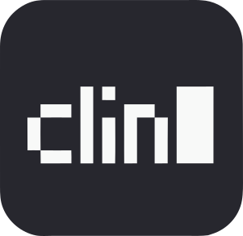

<div align="center">



# clin

**Your Markdown vault, in your terminal.**

A free, open-source note manager inspired by [Obsidian](https://obsidian.md/), built in Rust.
Write, connect, organize, and schedule notes in one terminal app.

[](https://github.com/reekta92/clin-rs/releases)
[](https://github.com/reekta92/clin-rs/actions/workflows/ci.yml)
[](LICENSE)

[Features](#features) · [Install](#installation) · [Quick start](#quick-start) · [Wiki](https://github.com/reekta92/clin-rs/wiki)

</div>


Browse your vault and preview notes without leaving the terminal.

## Features

| Workflow | What you can do | Guide |
|---|---|---|
| **Notes & editor** | Browse folders, search, tag, pin, and edit Markdown with previews, wikilinks, and an external editor. | [Notes](docs/LIST_VIEW.md) · [Editor](docs/EDITOR.md) |
| **Graph** | Explore connections between notes through an interactive, force-directed wikilink graph. | [Graph](docs/GRAPH_VIEW.md) |
| **Canvas** | Arrange text, files, links, and images on an infinite canvas using Obsidian's `.canvas` format. | [Canvas](docs/CANVAS.md) |
| **Bases** | Query and organize note properties in tables, lists, cards, and Kanban layouts. | [Bases](docs/BASES.md) |
| **Calendar** | Schedule linked notes, switch month/week/day/agenda views, import/export iCalendar, and sync manually with CalDAV. | [Calendar](docs/CALENDAR.md) |
| **Drawing** | Sketch freehand, add shapes and text, and pan or zoom your drawings. | [Draw](docs/DRAW.md) |
| **Themes** | Choose from 19 built-in themes or supply a custom TOML theme; customize colors, icons, and status lines. | [Themes](docs/THEME_SYSTEM.md) |

Also includes [templates](docs/TEMPLATES.md), [outlines](docs/OUTLINE.md), [subnotes](docs/SUBNOTES.md), daily writing goals, and file/URL imports with optional conversion and OCR tools.

<details>
<summary>See graph, canvas, and editor screenshots</summary>

<table>
  <tr>
    <td><br><b>Graph:</b> explore your wikilinks.</td>
    <td><br><b>Canvas:</b> arrange connected ideas.</td>
  </tr>
</table>


**Editor:** write and revise notes in the terminal.

</details>

## Installation

Download a package from [Releases](https://github.com/reekta92/clin-rs/releases), or use your preferred package manager:

| Platform | Install |
|---|---|
| Linux, Windows, macOS (from source) | `cargo install clin-rs --locked` — Rust 1.90.0+ |
| Arch Linux | `yay -S clin-rs-bin` |
| Nix | `nix run github:reekta92/clin-rs` — flakes enabled |
| Debian / Ubuntu | `.deb` for amd64 or arm64 |
| Fedora / RHEL | `.rpm` for x86_64 or aarch64 |
| Other Linux | Archives for x86_64/aarch64; AppImage for x86_64 |
| Windows | x86_64 `.zip` |
| macOS | Apple Silicon `.dmg` or archive; no Intel prebuilt binary |

See the [installation guide](docs/INSTALLATION.md) for platform commands, source builds, and optional tools. A modern terminal is recommended; native images depend on terminal support. Nerd Fonts are optional: use Unicode, emoji, or text-only icons with a regular font.

> **Upgrading an encrypted vault?** This release uses plaintext and no longer provides encryption or backups. Preserve your originals and keys; use the previous release to decrypt notes and recover legacy drafts. Read [Upgrading](docs/UPGRADING.md) first.

## Quick start

```sh
clin                                         # Launch; first run opens setup
clin --vault /path/to/vault                   # Open an existing vault
clin notes quick "Meeting notes" "Standup"    # Save a note without opening the TUI
```

With the default keybind preset:

| Key | Action |
|---|---|
| `j` / `k`, arrows | Move through the notes list |
| `Enter` | Open the selected note |
| `Ctrl+Space` / `F6` | Open the contextual command palette |
| `Ctrl+G` | Open the graph from Notes |
| `?` / `F1` | Open help from Notes |
| `F2` | Show current keybindings |
| `F4` | Switch vaults |

Use [setup](docs/SETUP.md) to choose your layout, features, appearance, and keybind preset. Open an existing Obsidian vault for Markdown, Canvas, and Bases workflows; Obsidian plugins are not executed. Review [Canvas](docs/CANVAS.md#obsidian-compatibility) and [Bases](docs/BASES.md) compatibility before relying on those workflows.

## CLI commands

Run `clin --help` or `clin notes --help` to discover commands. The [CLI guide](docs/CLI.md) covers note creation, shell input, templates, vault management, configuration, and cache commands.

## Documentation

Browse the **[Wiki](https://github.com/reekta92/clin-rs/wiki)** for all guides, or the [repository documentation index](docs/INDEX.md).

- **Customize:** [configuration](docs/CONFIG_REFERENCE.md), [keybind presets](docs/KEYBIND_PRESETS.md), [command palette](docs/COMMAND_PALETTE.md).
- **Terminal setup:** [images](docs/IMAGE_RENDERING.md), [clipboard and SSH](docs/EDITOR.md#clipboard-transport), [optional tools](docs/INSTALLATION.md#optional-tools).
- **Project:** [roadmap](ROADMAP.md), [architecture](docs/ARCHITECTURE.md), [contributing](CONTRIBUTING.md), [report a bug](https://github.com/reekta92/clin-rs/issues).

The Wiki syncs from `main`; documentation changes belong in the repository source files.

## Support & credits

Support development on [Patreon](https://www.patreon.com/MehmetDag/posts/clin-rs-project-163784358). Licensed under [GPL-3.0](LICENSE).

Built with [Ratatui](https://ratatui.rs), [Crossterm](https://github.com/crossterm-rs/crossterm), [graf](https://github.com/reekta92/graf-rs), [pinstar](https://github.com/reekta92/pinstar), and [draw-rs](https://github.com/reekta92/draw-rs). Markdown previews use comrak and syntect.

[Featured as Terminal Trove's Tool of the Week](https://terminaltrove.com/clin).
